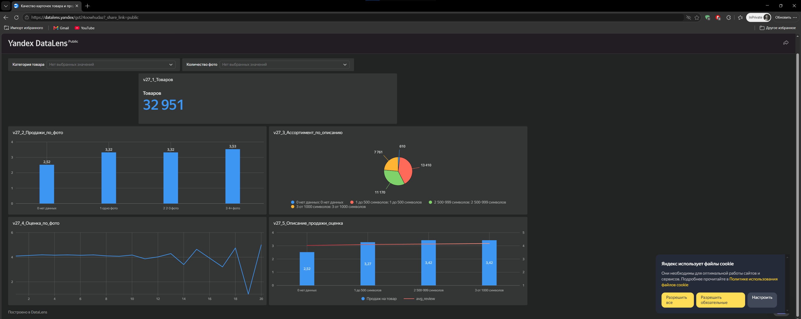
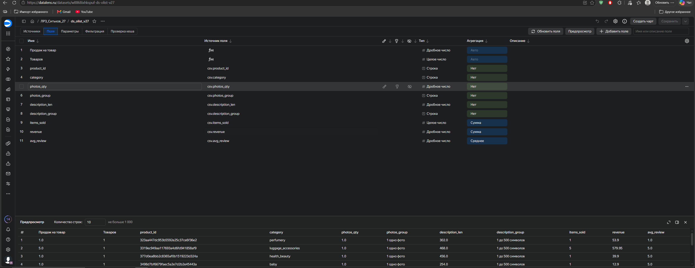
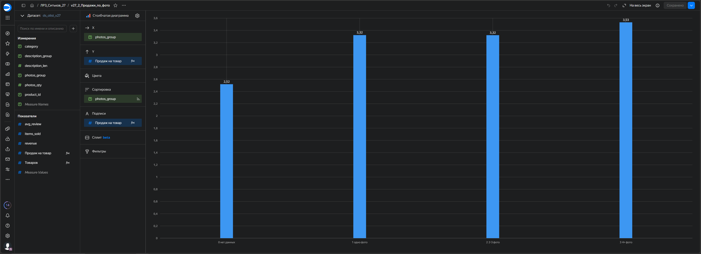

# ЛР3. Качество карточки товара и продажи

Ситьков Александр Вячеславович, БД-251м. Вариант 27.

## Цель и данные
Проверить связь фото и описания с продажами и оценками.
[Olist, Kaggle](https://www.kaggle.com/datasets/olistbr/brazilian-ecommerce),
девять CSV за 2016-2018 годы, CC BY-NC-SA 4.0.

## Метрики и расчёт
Товаров = COUNTD(product_id). Продаж на товар = SUM(items_sold) / COUNTD(product_id).
Выручка = SUM(revenue). Оценка = AVG(avg_review).

Одна строка витрины соответствует товару. Всего товаров 32951,
из них 735 без доставленных продаж. Продано 110197 единиц.
Выручка 13,221,498.11 BRL, без доставки. Продажи и отзывы агрегируются отдельно,
отзыв учитывается один раз на пару товар/заказ. Границы описания: менее 500,
500-999 и от 1000 символов.

## Архитектура и SQL
Python, SQLite: RAW -> STAGING -> CORE -> витрина -> CSV -> DataLens.
Выполнено в Google Colab: Python 3.13.18, pandas 2.2.3, SQLite 3.45.1.
[SQL витрины](sql/dm_v27_listing_quality.sql) сворачивает продажи и отзывы по product_id до соединения.

## Контрольные результаты
Результаты Colab и публичного дашборда без фильтров совпадают.
Одно фото: 3.32 продажи на товар.
4+ фото: 3.53.

## DataLens
[Открыть дашборд](https://datalens.yandex/gst24oowhudaz?_share_link=public).

Фильтры: category и photos_group.

Без фильтров 32 951 товар, для bed_bath_table 3 029, совместно с 4+ фото 111.
Оба фильтра проверены без авторизации.

## Выводы
1. С одним фото продажи составили 3.32 единицы на товар,
с 4+ фото 3.53. Разница 6.3%.

2. При описании короче 500 символов продажи составили 3.27,
при 500-999 символах 3.42, от 1000 символов 3.42.
После 500 символов заметного роста в этом сравнении нет.

3. Средняя оценка товара с одним фото 4.094,
с 4+ фото 4.164. Разница 0.070 балла невелика.

## Рекомендация
Проверить улучшение карточек на 100 товарах одной категории: 50 изменить,
50 оставить контрольными. Через четыре недели сравнить продажи на товар
при сопоставимых ценах и наличии. Цель пилота: рост на 5% относительно контроля,
а не гарантированный результат по историческим данным.

## Ограничения
Связь не доказывает причинность: нет данных о просмотрах, запасах и времени
публикации товара. У 610 товаров неизвестны фото и длина описания,
у 879 нет оценки. Пропуски сохранены отдельно. Оценка заказа отнесена к его товарам;
AVG(avg_review) усредняет оценки товаров, не всех заказов.
В STAGING исключены 551 лишняя строка отзыва, 3 платежа not_defined и 42 геоточки.
Исходный RAW сохранён.

